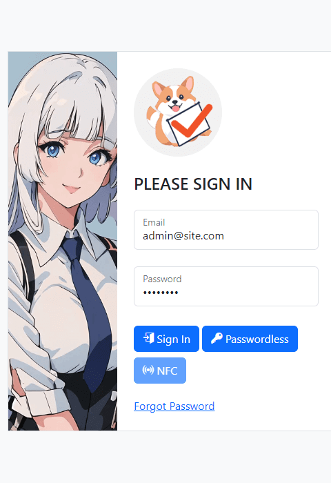
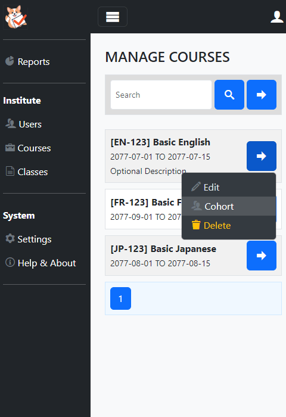
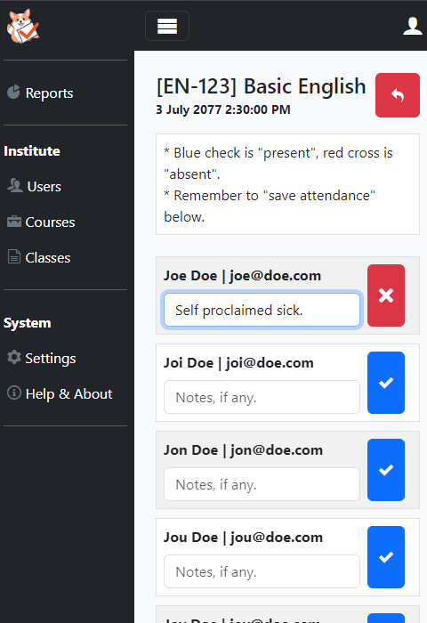
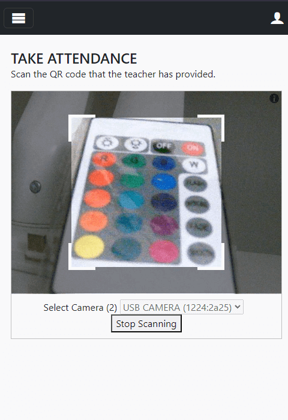
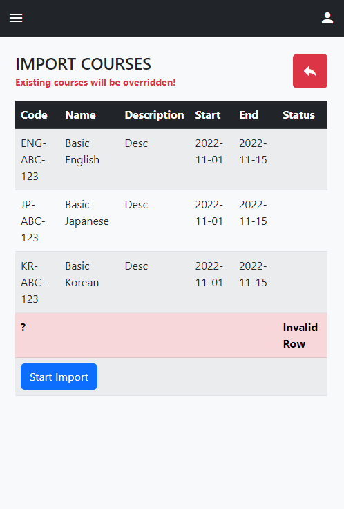

# I Was Here — Community Edition v2.5

I Was Here is an open-source PHP Student Attendance Management System. This
repository is a community-maintained continuation of the original project,
focused on security, reliability, accessibility, and practical improvements.
It is not an official upstream release.

The system features NFC and passwordless login, teacher-controlled rotating QR
attendance sessions, live teacher dashboards, configurable attendance
warnings, date-filtered analytics, bulk course enrollment, notification
preferences, student attendance summaries, correction requests, expiring
substitute-teacher access, configurable late-arrival summaries, and
teacher-reviewed offline check-in requests. Admins can define school holidays,
and class owners can cancel or reschedule sessions with an audit reason.
Excused absences are reported separately and excluded from attendance
percentages. Offline timestamps are unverified; offline requests do not count
as attendance until a teacher approves them. Student QR check-ins that lose
connectivity are stored locally with pending, syncing, synchronized, failed,
or expired states and retried idempotently when connectivity returns.
  

## :white_check_mark: FEATURES
1) NFC and passwordless login.
2) Installble progressive web app.
3) Take attendance manually or with a teacher-controlled rotating QR session.
4) Follow live class attendance and view student summaries and correction requests.
5) Configure the school-wide attendance warning threshold in System Settings.
6) Filter attendance reports by date and download CSV or open a print-friendly report.
7) Schedule opt-in notification delivery with `php /path/to/project/bin/send-notifications.php`; preview discovery safely with `--dry-run`.
  

## :camera: SCREENSHOTS

  
  
  
  
  
  

 

## :ballot_box_with_check: REQUIREMENTS
1) LAMP/WAMP/MAMP/XAMPP
2) Apache Mod Rewrite
3) PHP MYSQL PDO Extension
4) At least PHP 8.0
  

## :floppy_disk: INSTALLATION
1) Just copy/unzip into your `http` folder.
2) Access `http://your-site.com/` in your browser and walk through the installer.
  

## LOCAL DEVELOPMENT, TESTS & BACKUPS

- Use PHP 8.0 or newer with Apache `mod_rewrite`, PDO MySQL, OpenSSL, and a MySQL-compatible server such as MariaDB.
- In the installer, use the database hostname that the PHP process can reach. For containers, this is usually the database service name, not `localhost`.
- Run the JavaScript tests with `node --test tests/*.test.js`.
- Pull requests run PHP linting, JavaScript syntax checks, and the JavaScript
  regression suite through GitHub Actions on PHP 8.0 through 8.3.
- `GET /health.php` provides a readiness check for load balancers and
  monitoring. It returns only `{"status":"ok"}` or an unavailable status and
  never exposes database diagnostics.
- Run the database integration tests with `php tests/integration.php` only against a disposable development/test database. They create temporary records inside a transaction and roll it back; migrations are applied by the test. The current validation environment rejected its configured `root@localhost` credentials, so this suite still needs a working test database.
- Email notifications are opt-in and require PHP's `mail()` transport to be configured. Run `php bin/send-notifications.php --dry-run` to verify the worker without sending mail. In production, schedule `php /absolute/path/to/project/bin/send-notifications.php` with cron (for example every 15 minutes); failures retry up to five times and are logged.
- Back up the database regularly with `mysqldump --single-transaction --default-character-set=utf8mb4 --host=DB_HOST --user=DB_USER --password DB_NAME > attendance-backup.sql`. The command prompts for the password.
- Restore a backup with `mysql --host=DB_HOST --user=DB_USER --password DB_NAME < attendance-backup.sql`.
- Keep database and JWT secrets out of version control. Store backups securely and periodically test restoring them.
- Before production, use HTTPS, keep detailed PHP errors hidden from visitors, restrict database access and writable files, and review the configured API CORS policy.
- Authenticated API POST requests include a session-bound CSRF token generated
  by the application shell. Keep the standard browser client enabled so it can
  submit this token automatically.
- See [SECURITY.md](SECURITY.md) for private vulnerability reporting and
  production security requirements.
- Dependabot checks the bundled Composer dependencies and GitHub Actions
  weekly; review update pull requests before deploying them.
- To rotate JWT signing secrets, set `JWT_SECRET` to the new secret and keep
  the old value in `JWT_SECRET_PREVIOUS` until the configured session lifetime
  has elapsed; then clear the previous value.
- Administrators can enable TOTP MFA from My Account. Store the generated
  recovery codes securely; they are shown only during enrollment.
- Signed-in users can download a JSON export of their own account and
  attendance data from My Account.
- Administrators can configure security-event retention from System Settings
  (30 to 3650 days); expired events are automatically removed.
- Administrators can filter security events and expand structured event
  details from System Settings.
- Signed-in users can download their scheduled classes as an iCalendar feed
  from `/calendar.php`.

## BRANCHES, VERSIONS & ROLLBACKS

- `main` and tag `v2.0.0` are the Community Edition v2 baseline.
- Tag `v2.1.0` preserves the secure QR and student correction release.
- Tag `v2.2.0` preserves the initial live attendance dashboard release.
- Tag `v2.3.0` preserves configurable attendance-threshold warnings for students.
- Tag `v2.4.0` preserves date-filtered CSV and printable attendance reports.
- Tag `v2.5.0` preserves Phase 3 analytics, bulk course actions, schedule conflict checks, and opt-in email notifications.
- `v2-improvements` is the local development branch for ongoing improvements.
- The v2.0.0 tag is a preserved rollback point. To inspect it without changing branches, run `git switch --detach v2.0.0`; to continue work from it, create a branch with `git switch -c restore-v2.0.0 v2.0.0`.
- Keep each reviewed release as an annotated tag (for example, `v2.1.0`) and use `git revert <commit>` to undo a published change without rewriting history.
- The current branch and tags are local until explicitly pushed to the repository.

## :bulb: DOCUMENTATION
1) [How To Use](https://code-boxx.com/i-was-here-php-attendance-system/#sec-use)
2) [FAQ](https://code-boxx.com/core-boxx-php-framework/#sec-faq)
3) [For The Developers](https://code-boxx.com/i-was-here-php-attendance-system/#sec-dev)
4) [Current features and improvement ideas](features.md)
5) [Additional improvement roadmap and implementation status](improvements.md)

## :electric_plug: FRAMEWORKS
1) PHP Packages
   - [Core Boxx](https://code-boxx.com/core-boxx-php-framework/)
   - [PHP-JWT](https://github.com/firebase/php-jwt)
   - [PHP WebAuthn](https://github.com/lbuchs/WebAuthn/tree/master)
2) HTML JS
   - [Bootstrap](https://getbootstrap.com/)
   - [IconMoon](https://icomoon.io/)
   - [HTML5 QRCode Scanner](https://github.com/mebjas/html5-qrcode)
   - [QRCodeJS](https://davidshimjs.github.io/qrcodejs/)
   - [csv.js](https://github.com/okfn/csv.js/)
  

## :star: SUPPORT
Like this project? Just give it a star. That will indirectly help grow my blog a little bit. :wink:
  

## :newspaper: LICENSE
Copyright by Code Boxx

Permission is hereby granted, free of charge, to any person obtaining a copy
of this software and associated documentation files (the "Software"), to deal
in the Software without restriction, including without limitation the rights
to use, copy, modify, merge, publish, distribute, sublicense, and/or sell
copies of the Software, and to permit persons to whom the Software is
furnished to do so, subject to the following conditions:

The above copyright notice and this permission notice shall be included in all
copies or substantial portions of the Software.

THE SOFTWARE IS PROVIDED "AS IS", WITHOUT WARRANTY OF ANY KIND, EXPRESS OR
IMPLIED, INCLUDING BUT NOT LIMITED TO THE WARRANTIES OF MERCHANTABILITY,
FITNESS FOR A PARTICULAR PURPOSE AND NONINFRINGEMENT. IN NO EVENT SHALL THE
AUTHORS OR COPYRIGHT HOLDERS BE LIABLE FOR ANY CLAIM, DAMAGES OR OTHER
LIABILITY, WHETHER IN AN ACTION OF CONTRACT, TORT OR OTHERWISE, ARISING FROM,
OUT OF OR IN CONNECTION WITH THE SOFTWARE OR THE USE OR OTHER DEALINGS IN THE
SOFTWARE.